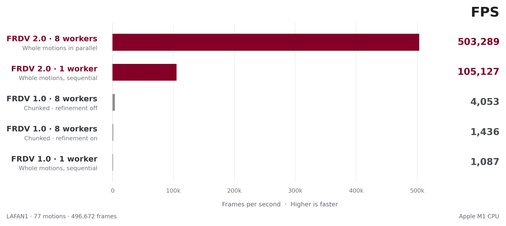

# FRDV 2.0

**We're excited to announce FRDV 2.0—our fastest motion-retargeting pipeline yet!**
Retarget **all 77 LAFAN1 motions (496,672 frames) onto Unitree G1
in 0.987 seconds—about 1 second** on an **Apple M1 CPU with 8 workers**.
That's **503,289 frames per second (FPS)**, or **1.99 microseconds per frame (µs/frame)**
of aggregate throughput—**about 124× faster than the fastest FRDV 1.0 setup**.

With even faster retargeting speed, whole-motion parallelism, reusable scaling profiles, and a Python API, FRDV 2.0 makes it practical to retarget large motion libraries and iterate on your settings.


### Fast Retargeting with Dynamics Validation

[](assets/demo/frdv_20_5MB.mp4)

Retarget human motion capture onto Unitree G1 using constrained kinematic optimization. Calibrate the human-to-robot alignment, retarget a motion, and inspect the saved robot trajectory in your browser.

**[Project page](https://daroslab.github.io/frdv/)**


## Install

Install [uv](https://docs.astral.sh/uv/getting-started/installation/) first. A source install
also needs a C compiler:

- **Linux / Ubuntu 24.04:** run `sudo apt update`, then `sudo apt install build-essential`.
- **macOS:** run `xcode-select --install`.

Then, from the repository root:

```bash
uv sync --locked --extra fast --extra cli --extra vis
```

Or install into your own Python environment with `pip install -e ".[fast,cli,vis]"`.
The examples below use `uv run`; with an activated environment, use the command names directly.

FRDV reports when it falls back to Numba or NumPy if the native solver is unavailable.

## Quick start

**1. Retarget:** convert the first 300 frames of the bundled clip and save the result:

```bash
uv run retarget robot=g1 dataset=lafan1 \
  data=assets/mocap/sample/walk3_subject5.bvh end=300 out=outputs/quickstart
```

**2. Play with Viser:** start the browser viewer for the saved motion:

```bash
uv run play outputs/quickstart
```

Open the URL printed in the terminal to view the motion.

## Retarget your data

### 1. LAFAN1

Download [lafan1.zip](https://github.com/ubisoft/ubisoft-laforge-animation-dataset/blob/master/lafan1/lafan1.zip)
from the [official LAFAN1 dataset folder](https://github.com/ubisoft/ubisoft-laforge-animation-dataset/tree/master/lafan1)
and extract it. Set `data` to the folder of `.bvh` files or to one clip:

```bash
uv run retarget robot=g1 dataset=lafan1 data=/path/to/lafan1 out=outputs/lafan1
uv run play outputs/lafan1
```

### 2. AMASS

Download motions from [AMASS](https://amass.is.tue.mpg.de/) and the original
[**16-beta SMPL+H NPZ models**](https://mano.is.tue.mpg.de/) from the MANO / SMPL+H website.
Register or sign in to access their download sections. Set the model folder containing
`male/model.npz`, `female/model.npz`, and/or `neutral/model.npz` for the genders in your data:

```bash
export SMPLH_MODEL_PATH=/path/to/smplh
uv run retarget robot=g1 dataset=amass data=/path/to/AMASS out=outputs/amass
uv run play outputs/amass
```

To use one of the 20 bundled ACCAD profiles, select it explicitly and point `data` at its folder:

```bash
uv run retarget robot=g1 dataset=amass subject=accad/Male1General_c3d \
  data=/path/to/ACCAD/Male1General_c3d out=outputs/accad_male1
uv run play outputs/accad_male1
```

AMASS folders are searched recursively. Keep outputs separate from input motions.
See the [AMASS guide](docs/amass.md) for input requirements and additional collections.

### 3. Other datasets or robots

For support for a new dataset or robot, please [open an issue](https://github.com/DARoSLab/FRDV/issues)
or [submit a pull request](https://github.com/DARoSLab/FRDV/compare).
G1, LAFAN1, and AMASS are the currently shipped presets.

## Scaling and calibration

| Dataset | Default | Manual option |
| --- | --- | --- |
| LAFAN1 | Automatic limb proportions, computed per clip | Saved G1 base or a tuned profile |
| AMASS | Saved manual G1 base or selected subject profile | Tune and reuse a subject profile |

Select `scaling=auto` or `scaling=manual` on a retarget command. Manual XYZ factors can be
overridden explicitly:

```bash
uv run retarget robot=g1 dataset=lafan1 data=assets/mocap/sample/walk3_subject5.bvh \
  scaling=manual 'dataset.scale.value=[0.76,0.78,0.74]' out=outputs/manual
uv run play outputs/manual
```

> **For best control over motion quality, use a manually tuned profile for each person/body shape
> and target robot.** Review it across several motions; see the
> [manual profile guide](docs/scaling.md#tune-and-save-a-subject-profile).

Saved manual scales and alignment offsets belong to a robot/dataset and are reused on every run.
**Hand/arm augmentation is off by default.** `augment` fits optional marker offsets; body-scale
fitting is a [separate offline step](docs/calibration.md#generate-body-profiles).

## Python usage

Run the same dataset pipeline from Python, including loading, scaling, solving, and saving.
Save this as `retarget_sample.py` and run `uv run python retarget_sample.py` from the repository root:

```python
import numpy as np
from frdv.cli.config import compose
from frdv.cli.retarget import run

settings = compose([
    "robot=g1",
    "dataset=lafan1",
    "data=assets/mocap/sample/walk3_subject5.bvh",
    "end=300",
    "out=outputs/python_sample",
])
if run(settings) != 0:
    raise RuntimeError("Retargeting failed; see the terminal output.")

with np.load("outputs/python_sample/walk3_subject5.npz") as motion:
    qpos = motion["qpos"]
print(qpos.shape)  # (300, 36): root position, root quaternion, 29 G1 joint angles
```

View the result with `uv run play outputs/python_sample`.
For direct `from frdv import IKConfig, Retargeter` usage, see the
[complete Python examples](docs/python_api.md), including how to build target arrays.

## Commands and execution

| Command | Purpose |
| --- | --- |
| `uv run retarget` | Retarget a motion file or folder. |
| `uv run play` | View one saved motion or a folder of motions. |
| `uv run check` | Inspect mapping, scale, and tracking errors on a short preview. |
| `uv run augment` | Fit optional hand/arm orientation-marker offsets. |
| `uv run new-robot` | Draft a custom robot mapping. |
| `uv run demo --clips 10` | Download LAFAN1 and G1, retarget, and open the viewer. |

**Within-file chunking is disabled by default.** One clip is solved sequentially; multiple clips
run concurrently, using the native whole-clip solver when available. Set `workers=1` for one
worker or `workers=8` for eight. Splitting a clip requires explicit `mode=chunks`.
Use `start=0 end=300` for a frame range (`end` is exclusive), and `<command> --help` for options.

Each saved `.npz` contains `qpos`, `fps`, tracking targets, and robot metadata for playback.
Root poses use `[x, y, z, qw, qx, qy, qz, ...joint angles]`; `frdv_config.yaml` records the run settings.

## Further documentation

- [Scaling and alignment](docs/scaling.md): tune XYZ factors, grounding, and optional augmentation.
- [Calibration profiles](docs/calibration.md): saved bases, subject overrides, and body-profile fitting.
- [AMASS](docs/amass.md): model requirements, profiles, and new collections.
- [Python API and runtime options](docs/python_api.md): complete examples, execution modes, and model caching.

For development checks, run `uv run python -m pytest -q`.

> **The dynamics-validation pipeline described in the paper is not included in this repository yet.**
> The current release contains the kinematic retargeting pipeline.

## Citation and license

If you use FRDV in your work, please cite
[Fast Motion Retargeting Pipeline for Scalable Humanoid Robot Learning](https://arxiv.org/abs/2610.28470).

```bibtex
@inproceedings{marew2026frdv,
  title = {Fast Motion Retargeting Pipeline for Scalable Humanoid Robot Learning},
  author = {Marew, Daniel and Park, Sangjun and Perera, Nisal and Kim, Donghyun},
  booktitle = {2026 IEEE-RAS International Conference on Humanoid Robots (Humanoids)},
  year = {2026}
}
```

Code is released under the [MIT License](LICENSE). Robot models retain their Menagerie/Unitree
licenses. LAFAN1 is copyright Ubisoft, CC BY-NC-ND 4.0. AMASS motions and SMPL+H models are obtained
separately under their respective dataset/model licenses.
